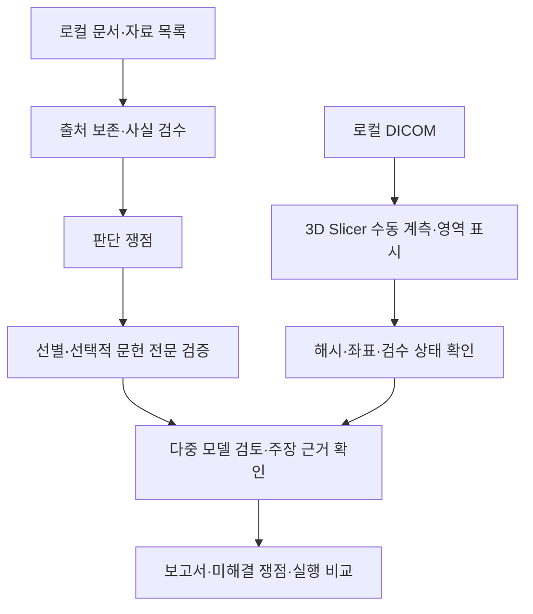

# MEDICAL SERVICE

### 근거와 검수 이력을 추적하는 로컬 의료 의사결정 지원 Agent

환자 문서에서 검수한 사실, 선택적으로 확인한 문헌, DICOM의 수동 계측을 연결해 **판단 쟁점과 추가 확인사항을 정리하는 연구용 CLI 프로토타입**입니다.

[Notion 프로젝트 포트폴리오](https://app.notion.com/p/MEDICAL-SERVICE-AI-40684b2a27f080039368ed9977a045b1) · [구조와 설계 판단](docs/ARCHITECTURE_KO.md) · [검증 범위](docs/VALIDATION_KO.md) · [DICOM 사용 안내](docs/DICOM_GUIDE_KO.md)

> 어떤 자료를 확인했고 무엇을 아직 모르는지 설명할 수 있는 시스템을 목표로 합니다. 자동 진단·자동 병변 분할·치료 실행은 구현 범위에 포함하지 않습니다.

## 왜 만들었나

진료기록, 영상 판독문, 원본 영상과 문헌은 서로 다른 조건과 시점의 정보를 담습니다. 이를 한 번에 요약하면 원문 사실과 AI 해석이 섞이고, 초록만 확인한 수치를 개인에게 적용하거나 촬영 조건 차이를 경과 변화로 오해할 수 있습니다. 이 프로젝트는 답변뿐 아니라 **출처·검수 상태·접근 범위·미해결 쟁점**을 함께 보존합니다.

## 구현한 기능

| 영역 | 주요 기능 |
| --- | --- |
| 자료 인입 | 파일·중첩 압축 조사, 해시와 출처 보존, 명시적 자료 역할 검수 |
| 사실 검수 | 원문 위치와 항목 연결, 즉시 저장, 수정·보류·철회 이력 |
| 문헌 검증 | 쟁점 생성, 제목·초록 선별 이유, 중요한 주장에 선택적 전문 분석, 구절·절·표 위치 |
| 모델 검토 | OpenAI·Anthropic·Google 독립 의견 → 상호 비평 → 수정 → 종합 → 주장별 근거 확인 |
| 영상 계측 | 로컬 DICOM 조사, Slicer 연동, LPS/RAS 변환, 수동 거리·각도·영역 계산과 재입력 검증 |
| 실행 제어 | 호출 전 비용 예약, 승인·가격 고정, 응답 유실 예약 유지, 캐시·재개 |
| 결과 | 문서 사실·영상 계측·문헌 근거·AI 해석·미해결 쟁점 분리, 실행 비교 |



## 검증 현황

- 2026-10-19 검증 기록: **196 passed · 1 skipped · 57 subtests passed**. 공개 스냅샷의 재검증 결과는 [검증 문서](docs/VALIDATION_KO.md)에 기록합니다.
- 실제 **Slicer 5.12.4**에서 합성 CT의 거리·각도·영역·좌표·픽셀·마스크 위치를 왕복 검증했습니다.
- 실제 CT **2개 시리즈, 총 510장**은 픽셀·기하·원본 해시와 빈 검수 결과 왕복을 확인했습니다. 원본과 개인 실행 기록은 이 저장소에 포함하지 않습니다.
- 실제 환자의 기준점·병변 계측 정확도, 전문가 일치도, 실시간 3개 제공자 통합 실행과 문헌 방식 비교는 **검증 대기**입니다. 테스트 통과는 임상 정확도 지표가 아닙니다.

## 로컬 설치와 오프라인 확인

Python 3.12 이상이 필요합니다. 아래 테스트는 합성 자료와 모의 제공자 응답을 사용합니다.

```powershell
git clone https://github.com/YIFNEN/medical-service.git
cd medical-service
py -3.12 -m venv .venv
& .\.venv\Scripts\Activate.ps1
python -m pip install -e ".[test]"
python -m pytest -q
python -m medic.cli --help
```

`scripts/`를 사용하는 Slicer 연동을 위해 저장소에서 editable 설치로 실행합니다. Slicer는 별도 설치가 필요하며 일반 pytest는 실제 Slicer를 자동 실행하지 않습니다.

### 합성 예제

`tests/fixtures/clinical_compiler/`는 `synthetic-ankle-001` 사례를 위한 합성 JSON 자료입니다. 실제 환자 기록이 아닙니다. 검수·상태 구성의 최소 흐름은 다음 테스트로 확인할 수 있습니다.

```powershell
python -m pytest tests/test_vertical_slice.py -q
```

### 주요 명령

`ingest` · `ingest-files` · `review` · `deliberate` · `resume` · `inventory` · `inventory-review` · `literature` · `dicom` · `compare-runs`

명령별 인수는 `python -m medic.cli <명령> --help`로 확인합니다. 실제 모델 호출에는 제공자 키, 모델별 가격 설정, 비용 승인과 예산이 필요합니다. 기본 설정은 개발 당시 스냅샷이므로 사용 전 모델 접근성과 가격을 확인해야 합니다. 외부 검색은 식별정보 없는 검색식 검수·승인 단계를 거칩니다. DICOM 원본과 영상 계측 경로는 로컬에서 처리합니다. 문서 추출·모델 검토를 실제 실행하면 선택한 입력이 제공자에게 전송될 수 있습니다.

## 소스 탐색

| 코드 | 역할 |
| --- | --- |
| `medic/inventory.py`, `material_roles.py`, `intake.py`, `extraction.py`, `ledger.py` | 자료 조사·인입·추출·검수 이력 |
| `medic/literature.py`, `evidence.py`, `evidence_appraisal.py` | 검색·선별·전문 검증과 위치별 근거 |
| `medic/workflow.py`, `tribunal.py`, `claim_grounding.py` | 재개 가능한 검토 흐름과 주장 검증 |
| `medic/imaging.py`, `imaging_geometry.py`, `slicer_review.py` | 영상 적합성·좌표·검수 왕복 |
| `medic/budget.py`, `call_cache.py`, `reporting.py`, `comparison.py` | 비용·캐시·보고서·실행 비교 |
| `scripts/`, `tests/` | Slicer 브리지·런타임 검증 스크립트·오프라인 회귀 |

## 개발 방식과 공개 범위

개인 프로젝트로 요구사항·우선순위·수용 기준을 정하고 Codex와 협업해 구현, 오류 재현, 반복 검증을 진행했습니다. 공개본은 **2026-10-28에 선별한 소스 스냅샷**입니다. 개인 의료 맥락이 담긴 기존 Git 이력, 의료 원본, 실행 원장, 인증정보와 로컬 설치 파일은 옮기지 않았습니다.

Python · Pydantic · NumPy · pydicom · 3D Slicer · PyMuPDF · httpx · pytest
