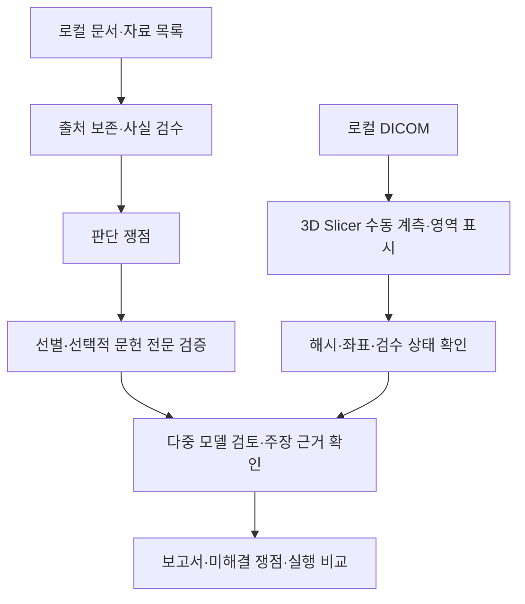

# MEDICAL SERVICE

### 근거와 검수 이력을 추적하는 로컬 의료 의사결정 지원 Agent

환자 문서에서 검수한 사실, 선택적으로 확인한 문헌, DICOM의 수동 계측을 연결해 **판단 쟁점과 추가 확인사항을 정리하는 연구용 CLI 프로토타입**입니다.

[Notion 프로젝트 포트폴리오](https://app.notion.com/p/MEDICAL-SERVICE-AI-40684b2a27f080039368ed9977a045b1) · [구조와 설계 판단](docs/ARCHITECTURE_KO.md) · [검증 범위](docs/VALIDATION_KO.md) · [DICOM 사용 안내](docs/DICOM_GUIDE_KO.md)

> 어떤 자료를 확인했고 무엇을 아직 모르는지 설명할 수 있는 시스템을 목표로 합니다. 자동 진단·자동 병변 분할·치료 실행은 구현 범위에 포함하지 않습니다.

## 왜 만들었나

### 출발점: 오래 기다린 진료에서 충분히 다뤄지지 않는 과거

제가 경험한 대학병원 진료에서는 미리 영상 CD를 제출하고, 교수 진료에 앞서 다른 의사와 문진하며 정보를 정리했습니다. 수개월을 기다려 만난 교수는 정리된 자료를 바탕으로 짧은 시간 안에 판단해야 했습니다. 그 과정에서 장기간의 과거 기록과 변화가 충분히 다뤄지는지 의문이 들었고, 같은 환자의 상태에 대해서도 대학병원마다 판단의 방향이 크게 달라지는 경험을 했습니다.

### 또 하나의 출발점: CD 백업을 재사용 가능한 의료 기록으로

해외 일부 병원에는 환자가 영상과 기록을 온라인으로 확인·다운로드하는 경로가 있습니다. 예를 들어 [Cambridge University Hospitals는 영상이 포함된 기록의 온라인 열람·다운로드를 안내합니다](https://www.cuh.nhs.uk/patient-privacy/accessing-your-health-records/). 제가 국내에서 경험한 자료 수령 방식은 CD 발급이었고, CD를 잃어버리면 다시 병원에 방문해 발급 비용을 내야 하는 번거로움이 있었습니다. 국내외 모든 병원의 제공 방식이 같다는 뜻은 아닙니다.

그래서 CD 리더기를 구입해 영상을 컴퓨터에 백업하기 시작했습니다. 이때 **보관한 파일을 의료 판단에 활용하기 좋은 형태로 가공하고 기록해 두면, AI가 현재 상태를 검토할 때 과거 지표도 의미 있게 사용할 수 있지 않을까?**라는 생각으로 이어졌습니다. 단순 파일 보관에서 더 나아가, 출처와 검사 조건을 보존한 개인의 장기 의료 기록을 만드는 것이 중요한 개발 동기입니다.

### 육안으로 느낀 변화를 수치로 확인할 수 있을까

영상이나 이미지의 각도·거리·변화를 눈으로 추정하는 데 더해, 픽셀·복셀과 촬영 기하를 이용해 수치로 계산하면 더 정밀하고 반복 가능한 비교가 가능하지 않을까 하는 가설도 있었습니다. 그래서 DICOM의 공간 정보와 검수된 기준점을 이용하는 계측 경로를 설계했습니다.

정량 계측을 수행한다는 사실이 사람보다 높은 임상 정확도를 보장하지는 않습니다. [Slicer의 영상 공간은 원점·방향·복셀 간격으로 정의되며](https://slicer.readthedocs.io/en/latest/user_guide/modules/volumes.html), 실제 정확도는 해상도·보정·촬영 자세·기준점과 계측 방법의 적합성을 따로 확인해야 합니다. 현재는 **사람이 지정한 기준점과 영역의 거리·각도·면적·부피 계산**을 구현했으며, 과거와 현재 영상의 자동 정합·동일 부위 추적·자동 변화 탐지는 구현하지 않았습니다.

### 문제 가설: 시간·정보 가공·경험·가치의 병목

저는 이러한 차이에 의사가 접해 온 환자 사례와 경험의 편향, 짧은 진료시간, 정보를 전달하기 위한 요약·전처리 과정, 기관이나 의사가 중요하게 여기는 가치와 우선순위가 영향을 줄 수 있다고 생각했습니다. 특히 진료시간에 맞춰 정보를 압축하는 동안 환자의 과거 경과와 세부 맥락이 충분히 전달되지 못하는 것을 중요한 병목으로 봤습니다. 이는 프로젝트를 시작하게 한 개인적 관찰과 원인 가설이며, 진료 차이의 원인을 검증한 연구 결과는 아닙니다.

### 만들고 싶은 것: 한 환자의 변화를 오래 살펴보는 의료 판단 AI

의료 판단에도 과학적 근거가 있고, 필요한 정보와 조건을 충분히 살피면 그 환자에게 **최선의 판단에 접근할 수 있다**는 가정에서 medic을 시작했습니다. DICOM과 의무기록사본을 의료 판단에 활용하기 좋은 형태로 가공하고, 비교적 오랜 시간이 걸리더라도 환자의 의료 데이터가 시간에 따라 어떻게 변했는지 관찰하며, 개인의 상황과 성향까지 고려해 선택지를 검토하는 AI를 만들고 싶었습니다.

여기서 최선의 판단은 의학적 근거와 함께 환자가 중요하게 여기는 목표·위험 감수 수준·생활 조건을 명시한 뒤 찾고자 하는 목표입니다. 현재 구현이 그러한 최선의 판단을 보장하거나 의사보다 정확하다고 검증된 것은 아닙니다.

> **개발 목표: 진료의 시간과 정보 처리에서 발생하는 병목을 줄이고, 한 환자의 과거부터 현재까지의 변화와 개인의 조건을 충분히 살펴 근거 있는 의료 판단을 돕는 것.**

### 이 동기를 설계로 옮긴 방법

| 발견한 병목 | medic의 설계 방향 |
| --- | --- |
| 짧은 진료시간에 맞춘 정보 압축 | 출처를 보존한 구조화 기록과 재개 가능한 분석으로 상세 검토를 지원 |
| 최근 상태 중심으로 정리되는 정보 | 과거 기록·영상 계측·검수 이력을 연결하고 시점별 변화를 비교 |
| CD를 보관하는 데 머무르는 의료자료 | 로컬에 복사한 파일을 해시·원문 위치·검사·시리즈·검수 이력이 연결된 자료로 가공 |
| 육안으로 추정하는 각도와 변화 | 촬영 기하와 수동 기준점에 기반한 정량 계측. 자동 영상 변화 탐지와 임상적 우월성은 미검증 |
| 경험과 관점에 따라 달라지는 판단 | 여러 모델의 독립 의견과 상호 비평, 확인 가능한 문헌 근거를 연결. 모델 간 합의를 정확성의 증명으로 사용하지 않음 |
| 환자와 판단 주체가 중요하게 여기는 가치의 차이 | 개인의 상황·성향·우선순위를 판단 조건으로 명시하는 방향을 지향. 이를 체계적으로 수집·반영하는 기능과 효과는 후속 검증 과제 |

진료기록, 영상 판독문, 원본 영상과 문헌은 서로 다른 조건과 시점의 정보를 담습니다. 따라서 답변뿐 아니라 **출처·검수 상태·접근 범위·미해결 쟁점**을 함께 보존하고, 원문 사실·영상 계측·문헌 결과·AI 해석을 구분하도록 구현했습니다.

## 구현한 기능

| 영역 | 주요 기능 |
| --- | --- |
| 자료 인입 | 파일·중첩 압축 조사, 해시와 출처 보존, 명시적 자료 역할 검수 |
| 사실 검수 | 원문 위치와 항목 연결, 즉시 저장, 수정·보류·철회 이력 |
| 문헌 검증 | 쟁점 생성, 제목·초록 선별 이유, 중요한 주장에 선택적 전문 분석, 구절·절·표 위치 |
| 모델 검토 | OpenAI·Anthropic·Google 독립 의견 → 상호 비평 → 수정 → 종합 → 주장별 근거 확인 |
| 영상 계측 | 로컬 DICOM 조사, Slicer 연동, LPS/RAS 변환, 수동 거리·각도·영역 계산과 재입력 검증 |
| 실행 제어 | 호출 전 비용 예약, 승인·가격 고정, 응답 유실 예약 유지, 캐시·재개 |
| 결과 | 문서 사실·영상 계측·문헌 근거·AI 해석·미해결 쟁점 분리, 실행 비교 |

### 데이터 가공은 어디까지 구현했나

현재는 **컴퓨터에 이미 복사한 자료를 분석 가능한 기록으로 만드는 경로**를 구현했습니다. 광학 드라이브에서 CD를 자동으로 복제하거나 병원 웹사이트에서 자료를 자동 다운로드하는 기능은 포함하지 않습니다.

| 단계 | 현재 구현 | 범위와 한계 |
| --- | --- | --- |
| 자료 목록과 무결성 | 파일·지원 ZIP/ISO 내부 경로, 해시, 처리 상태 기록; 해시 기반 중복 식별과 원본 재검증 | 원본은 수정하지 않음. 미지원·손상·안전 한도 초과 자료는 미처리 상태와 이유 보존 |
| 원본 보존과 문서 구조화 | 인입한 문서의 내용 해시 기반 원본 보존; PDF 페이지·텍스트 영역·bounding box 연결; 필요 시 페이지 이미지 보존 | 페이지 이미지 보존 자체가 OCR·본문 해석 완료를 뜻하지 않음 |
| 자료 역할과 사실 검수 | 환자 기록·문헌 등 명시적 역할, 사례·검수 서지정보 연결; 추출 사실의 원문 위치와 수정·보류·철회 이력 | 역할 검수와 자동 진단을 구분; 실제 제공자 기반 추출의 종단 검증은 대기 |
| 영상 구조화 | 확장자 없는 DICOM·DICOMDIR 조사, Study/Series/SOP UID와 해시로 정리; 날짜·좌우·방향·간격·슬라이스 순서와 적합성 검사 | DICOMDIR 참조를 자동으로 따라가지 않음. 다중 프레임·압축 등은 현재 검사 전용; 체중부하 미확인은 UNKNOWN |
| 계측의 재사용 | 적합한 CT/MR·조건을 충족한 2D 영상의 수동 기준점/영역을 Slicer로 검토; 원본·좌표·단위·방법·검수 상태를 연결해 저장·재입력 | 평가 영역이 있을 때만 영역 비율 계산; 정상/국소/광범위 자동 판정 없음 |
| 과거 기록의 활용 | 검수 이력과 계측을 사례 컨텍스트에 연결; 실행 간 사실·근거·영상 검수·의견 변경을 구분해 비교 | 원본 영상 자동 정합이나 정량 변화 곡선 생성 기능은 아님. 차이를 자동 악화·호전으로 해석하지 않음 |

구현 코드와 테스트의 연결은 [데이터 가공 범위](docs/DATA_PROCESSING_KO.md)에 정리했습니다. 실제 Slicer 합성 계측 왕복과 CT 510장 기술 검증은 확인했으며, 환자의 실제 해부학적 계측 정확도와 장기 경과 판단 효과는 별도 검증이 필요합니다.



## 검증 현황

- 2026-10-19 검증 기록: **196 passed · 1 skipped · 57 subtests passed**. 공개 스냅샷의 재검증 결과는 [검증 문서](docs/VALIDATION_KO.md)에 기록합니다.
- 실제 **Slicer 5.12.4**에서 합성 CT의 거리·각도·영역·좌표·픽셀·마스크 위치를 왕복 검증했습니다.
- 실제 CT **2개 시리즈, 총 510장**은 픽셀·기하·원본 해시와 빈 검수 결과 왕복을 확인했습니다. 원본과 개인 실행 기록은 이 저장소에 포함하지 않습니다.
- 실제 환자의 기준점·병변 계측 정확도, 전문가 일치도, 실시간 3개 제공자 통합 실행과 문헌 방식 비교는 **검증 대기**입니다. 테스트 통과는 임상 정확도 지표가 아닙니다.

## 로컬 설치와 오프라인 확인

Python 3.12 이상이 필요합니다. 아래 테스트는 합성 자료와 모의 제공자 응답을 사용합니다.

```powershell
git clone https://github.com/YIFNEN/medical-service.git
cd medical-service
py -3.12 -m venv .venv
& .\.venv\Scripts\Activate.ps1
python -m pip install -e ".[test]"
python -m pytest -q
python -m medic.cli --help
```

`scripts/`를 사용하는 Slicer 연동을 위해 저장소에서 editable 설치로 실행합니다. Slicer는 별도 설치가 필요하며 일반 pytest는 실제 Slicer를 자동 실행하지 않습니다.

### 합성 예제

`tests/fixtures/clinical_compiler/`는 `synthetic-ankle-001` 사례를 위한 합성 JSON 자료입니다. 실제 환자 기록이 아닙니다. 검수·상태 구성의 최소 흐름은 다음 테스트로 확인할 수 있습니다.

```powershell
python -m pytest tests/test_vertical_slice.py -q
```

### 주요 명령

`ingest` · `ingest-files` · `review` · `deliberate` · `resume` · `inventory` · `inventory-review` · `literature` · `dicom` · `compare-runs`

명령별 인수는 `python -m medic.cli <명령> --help`로 확인합니다. 실제 모델 호출에는 제공자 키, 모델별 가격 설정, 비용 승인과 예산이 필요합니다. 기본 설정은 개발 당시 스냅샷이므로 사용 전 모델 접근성과 가격을 확인해야 합니다. 외부 검색은 식별정보 없는 검색식 검수·승인 단계를 거칩니다. DICOM 원본과 영상 계측 경로는 로컬에서 처리합니다. 문서 추출·모델 검토를 실제 실행하면 선택한 입력이 제공자에게 전송될 수 있습니다.

## 소스 탐색

| 코드 | 역할 |
| --- | --- |
| `medic/inventory.py`, `material_roles.py`, `intake.py`, `extraction.py`, `ledger.py` | 자료 조사·인입·추출·검수 이력 |
| `medic/literature.py`, `evidence.py`, `evidence_appraisal.py` | 검색·선별·전문 검증과 위치별 근거 |
| `medic/workflow.py`, `tribunal.py`, `claim_grounding.py` | 재개 가능한 검토 흐름과 주장 검증 |
| `medic/imaging.py`, `imaging_geometry.py`, `slicer_review.py` | 영상 적합성·좌표·검수 왕복 |
| `medic/budget.py`, `call_cache.py`, `reporting.py`, `comparison.py` | 비용·캐시·보고서·실행 비교 |
| `scripts/`, `tests/` | Slicer 브리지·런타임 검증 스크립트·오프라인 회귀 |

## 개발 방식과 공개 범위

개인 프로젝트로 요구사항·우선순위·수용 기준을 정하고 Codex와 협업해 구현, 오류 재현, 반복 검증을 진행했습니다. 공개본은 **2026-10-28에 선별한 소스 스냅샷**입니다. 개인 의료 맥락이 담긴 기존 Git 이력, 의료 원본, 실행 원장, 인증정보와 로컬 설치 파일은 옮기지 않았습니다.

Python · Pydantic · NumPy · pydicom · 3D Slicer · PyMuPDF · httpx · pytest
